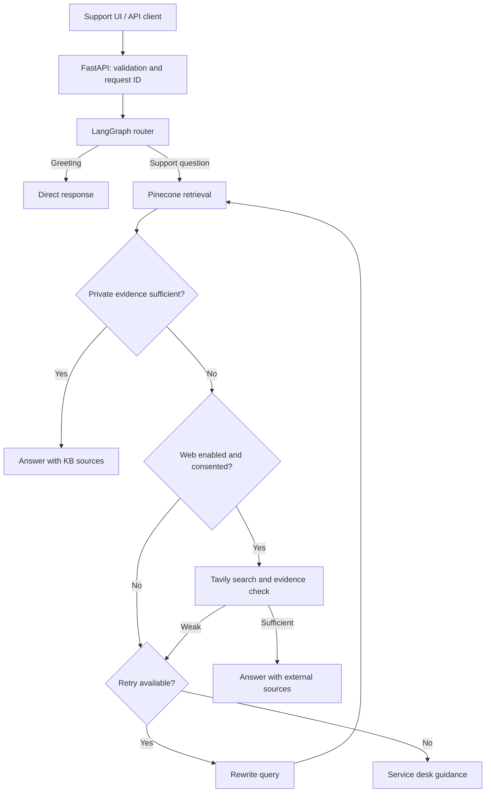

# DeskPilot AI

**IT support guidance with evidence checks, source citations, and a traceable retrieval workflow.**

Maintainer: **Hamza Iqbal Malik** · Version: **0.2.0** · License: **Apache-2.0**

DeskPilot helps employees find answers in an organization's IT knowledge base. A LangGraph workflow retrieves internal documents, checks whether they address the question, and either generates a grounded response, rewrites the query for another retrieval attempt, or directs the employee to the service desk. Optional public search requires both administrator enablement and explicit consent on the request.

## Problem and approach

IT support teams handle repeated questions about VPN access, password resets, MFA, and device setup while approved guidance is scattered across documents. DeskPilot brings that knowledge into one support interface and records the evidence checks behind each answer.

The workflow prioritizes internal policy, uses external information only when explicitly permitted, and returns a service-desk outcome when evidence remains insufficient. Index compatibility checks protect existing knowledge, and repeat ingestion uses stable vector IDs.

**Status:** API, workflow, ingestion, and regression coverage are implemented. Live answer-quality evaluation and deployment validation are pending; see [VALIDATION.md](VALIDATION.md).

## Capabilities

| Area | Implemented behavior |
| --- | --- |
| Data protection | Incompatible Pinecone indexes cause an error; existing vectors are never automatically deleted. Index readiness polling has a deadline. |
| External search | Disabled by default. Both `ENABLE_WEB_SEARCH=true` and request `allow_web=true` are required. Private evidence is preferred even when web search is allowed. |
| Document ingestion | Admin key required; blank/default keys disable ingestion. Upload byte limit, unique temporary paths, cleanup after parsing/indexing, and content-derived document IDs. |
| Repeat ingestion | Stable chunk IDs upsert an identical document instead of adding fresh IDs each time. Changed documents create new IDs; old-version cleanup is still a roadmap item. |
| Observability | Response and header request IDs, elapsed workflow/audit time, retry count, source decision, and SQLite audit events. |
| Audit privacy | Raw questions omitted by default; rewritten query text excluded from stored traces. Question hashes are fingerprints, not anonymization. |
| API behavior | Trimmed/validated questions, typed chat responses, generic provider errors, and an explicit insufficient-evidence outcome. |
| Parsing | PDF/text/Markdown readers and DOCX paragraphs plus tables. Scanned documents require OCR outside this application. |
| Delivery | Non-root Docker image, health probe, environment example, CI definition, automated regression tests, architecture and operations documentation. |

## Architecture



The graph uses one OpenAI chat model for routing, grading, rewriting, and generation. It is a stateful conditional workflow, with no specialist-agent delegation or autonomous remediation. Each chat request is independent; displayed UI history is not model conversation memory.

| Component | Implementation |
| --- | --- |
| API and browser UI | FastAPI, Jinja2, HTML/CSS/JavaScript |
| Workflow | LangGraph and structured Pydantic decisions |
| Chat model | OpenAI, configurable with `OPENAI_MODEL` |
| Embeddings | OpenAI `text-embedding-3-small` by default, 1,536 dimensions |
| Retrieval | Pinecone cosine similarity, namespace and top-k configurable |
| Optional web evidence | Tavily |
| Audit storage | SQLite |
| Document handling | pypdf, python-docx, LangChain text splitter |

## Run locally

Requires Python **3.11 or 3.12**, an OpenAI API key, and a Pinecone API key. Provider calls incur usage charges. Tavily is needed only when public search is enabled.

```bash
python -m venv .venv
source .venv/bin/activate
# Windows PowerShell: .venv\Scripts\Activate.ps1
python -m pip install -r requirements.txt
cp .env.example .env
# Windows PowerShell: Copy-Item .env.example .env
```

Set `OPENAI_API_KEY` and `PINECONE_API_KEY` in `.env`. Set a random `ADMIN_API_KEY` if document uploads are needed:

```bash
python -c 'import secrets; print(secrets.token_urlsafe(32))'
```

Use an isolated index/namespace for initial testing. The ingestion script creates a missing Pinecone index and writes vectors. An incompatible existing index is preserved and reported as an error.

```bash
python ingest_sample_kb.py
python run.py
```

Open [http://127.0.0.1:8080](http://127.0.0.1:8080). Interactive API docs are at [http://127.0.0.1:8080/docs](http://127.0.0.1:8080/docs).

The included `data/sample_kb` documents are fictional fixtures for local validation. Replace them with approved organization-specific documents and re-ingest before relying on the answers. Chat and embedding models are configurable through environment variables.

## Configuration

Settings load from environment variables or the root `.env` file. Never commit credentials.

| Variable | Default | Purpose |
| --- | --- | --- |
| `APP_NAME` | `DeskPilot AI` | API title and interface name |
| `APP_ENV` | `development` | Environment label; does not enforce security controls |
| `OPENAI_API_KEY` | Empty | Required for the chat model and embeddings |
| `OPENAI_MODEL` | `gpt-4o-mini` | Routing, grading, rewriting, and generation |
| `EMBEDDING_MODEL` | `text-embedding-3-small` | Supported: small, large, or ada-002 OpenAI embeddings |
| `PINECONE_API_KEY` | Empty | Required for knowledge retrieval and ingestion |
| `PINECONE_INDEX_NAME` | `deskpilot-it-support` | Vector index |
| `PINECONE_NAMESPACE` | `company-it-kb` | Namespace; does not provide per-user authorization |
| `PINECONE_CLOUD` / `PINECONE_REGION` | `aws` / `us-east-1` | Placement of newly created indexes |
| `TOP_K` | `4` | Retrieved chunks; accepted range 1–20 |
| `MAX_RETRIES` | `1` | Query rewrites; accepted range 0–3 |
| `INDEX_READY_TIMEOUT_SECONDS` | `60` | Readiness polling budget; excludes individual SDK call duration |
| `PROVIDER_TIMEOUT_SECONDS` | `30` | OpenAI timeout per attempt; provider retry count is 1 |
| `ENABLE_WEB_SEARCH` | `false` | Server gate for public search |
| `TAVILY_API_KEY` | Empty | Required only for enabled public search |
| `ADMIN_API_KEY` | Empty | Upload credential; empty and known placeholder values disable ingestion |
| `MAX_UPLOAD_BYTES` | `10485760` | 10 MiB extracted upload file limit |
| `AUDIT_STORE_QUESTIONS` | `false` | Opt-in storage of raw questions |
| `AUDIT_DB_PATH` | `data/audit.db` under project root | SQLite audit file |
| `UPLOAD_DIR` | `uploads` under project root | Temporary parsing directory |
| `SAMPLE_KB_DIR` | `data/sample_kb` under project root | Fixture ingestion directory |

Changing embedding models requires a compatible new index and re-ingestion. Matching dimensions alone does not guarantee compatible vectors; avoid mixing models in an index.

## API

### Ask a support question

```bash
curl -X POST http://127.0.0.1:8080/api/chat \
  -H 'Content-Type: application/json' \
  -d '{"question":"How do I connect to the company VPN?","allow_web":false}'
```

The response contains `answer`, `source_used`, `citations`, `trace`, `rewritten_query`, `request_id`, `latency_ms`, and `retry_count`. `X-Request-ID` matches the response identifier. Source values are `private_kb`, `web_search`, `direct`, or `insufficient_evidence`.

Citations identify retrieved evidence; they do not prove every generated sentence is supported. Latency measures the workflow and audit write, not network transit or queue time.

### Add approved knowledge

```bash
# Set DESKPILOT_ADMIN_KEY in your shell to the configured upload key first.
curl -X POST http://127.0.0.1:8080/api/ingest \
  -H "X-Admin-Key: ${DESKPILOT_ADMIN_KEY}" \
  -F 'file=@data/sample_kb/company_it_handbook.md'
```

Supported formats: PDF, TXT, MD, DOCX. The API extracts text, chunks it into approximately 900-character segments with 120-character overlap, embeds the chunks, and upserts them into Pinecone. Temporary uploaded originals are removed after processing. Responses return the content hash, chunk count, and returned vector ID count; these are not a count of newly inserted records.

| Endpoint | Purpose |
| --- | --- |
| `GET /` | Support interface |
| `GET /api/health` | Process liveness; no provider readiness checks |
| `POST /api/chat` | Stateless support guidance |
| `POST /api/ingest` | Admin-key protected knowledge ingestion |

## Tests and quality checks

```bash
python -m pip install -r requirements-dev.txt
python -m pip check
ruff check app tests run.py ingest_sample_kb.py
ruff format --check app tests run.py ingest_sample_kb.py
pytest -q
```

The regression suite exercises the API, audit privacy defaults, upload cleanup, stable vector IDs, index compatibility guards, bounded readiness waits, DOCX table extraction, and compiled graph routes. Providers are replaced with controlled fakes; no test API keys or live provider calls are required.

A GitHub Actions workflow runs these checks on Python 3.11 and 3.12 when committed to your repository. Local checks were performed on Python 3.12; the CI matrix is configuration, not evidence that hosted CI has run. See [evaluation guidance](docs/EVALUATION.md) for live answer-quality validation.

## Docker

```bash
docker build -t deskpilot-ai .
docker run --rm --env-file .env -p 8080:8080 \
  -v deskpilot-data:/app/data deskpilot-ai
```

The container runs as a non-root user and uses a liveness health probe. The named volume persists audit storage. Docker image build/runtime has not been validated in this workspace. Local `run.py` uses reload for development; the container uses Uvicorn without reload.

## Operational limits and next work

Implemented controls provide a foundation for an internal pilot. Before enterprise deployment, prioritize:

- SSO/OIDC for chat access, role checks for uploads, and document-level access filtering.
- A reverse proxy with TLS, request body limits, rate limits, and end-to-end timeouts.
- Approved external-search query redaction and vendor-domain restrictions.
- Background ingestion jobs, malware scanning, parser isolation, and document-version deletion.
- Live retrieval/groundedness evaluation, prompt-injection testing, and monitoring.
- Managed audit retention, backups, deletion policy, and a database appropriate for multi-instance use.

Do not expose this app directly to the internet. Chat is currently unauthenticated, knowledge is shared within the configured namespace, and `APP_ENV=production` does not change that. OpenAI receives questions and retrieved evidence; Pinecone stores document text and vectors; permitted Tavily searches receive the original or rewritten question. See [security boundaries](SECURITY.md), [architecture decisions](docs/ARCHITECTURE.md), and [operations](docs/OPERATIONS.md). Engineering details are in [docs/ENGINEERING.md](docs/ENGINEERING.md).

## Repository layout

```text
app/
  api/routes.py          API contracts, uploads, and provider error handling
  core/                  Configuration and logging
  rag/                   State, graph, and vector access
  services/              Audit storage and document extraction
  main.py                Application lifecycle and request IDs
static/                  Browser scripts and styles
templates/               Support interface
data/sample_kb/          Fictional document fixtures
tests/                   Regression coverage
docs/                    Architecture, operations, evaluation, and engineering notes
.github/workflows/       CI configuration
.env.example             Configuration template
Dockerfile               Non-root container packaging
```

## License

Licensed under [Apache-2.0](LICENSE). Third-party attribution is recorded in [NOTICE](NOTICE).
